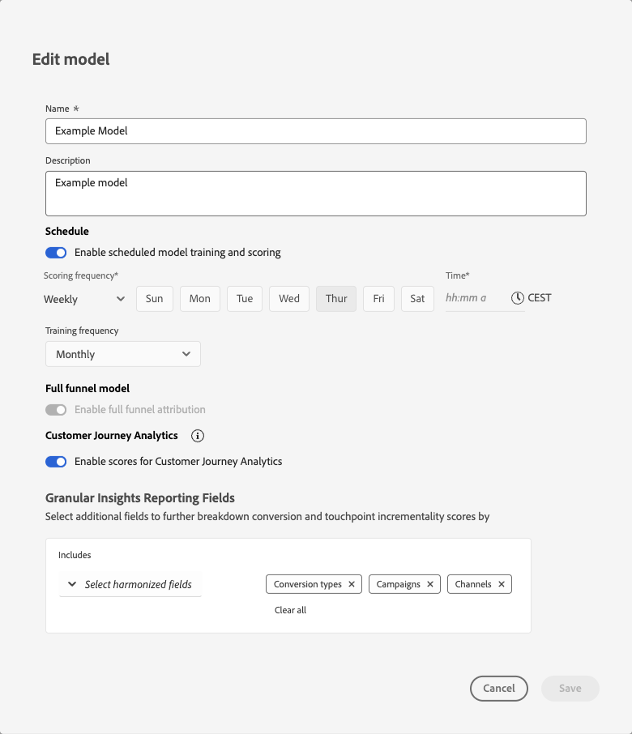

# モデルの概要

{{mm-mca-rebranding}}

Marketing Campaign Analyticsのモデル機能を使用すると、ビジネス目標に合わせてモデルを設定、トレーニング、スコアリングできます。 トレーニングとスコアリングは、マルチタッチアトリビューションとマーケティングミックスモデリング間の、AIを活用した転送学習をサポートします。

モデルは、アプリケーションワークフローの一部として作成した調整済みデータに基づいています。

Marketing Campaign Analyticsのモデルは、マーケティングへの投資にもとづいて特定の結果を測定および予測するために使用されるマシンラーニングモデルです。 マーケティングのタッチポイントや概要レベルのデータを入力として利用できます。 Marketing Campaign Analyticsを活用すれば、様々な変数、ディメンション、結果（収益、販売個数、リードなど）のセットにもとづいてモデルのバリエーションを作成できます。

モデルには次のものが必要です。

* コンバージョンをひとつ。
* サマリーレベルのデータ、マーケティング顧客接点データ（イベントデータ）またはその両方で構成される1つ以上のマーケティング顧客接点（チャネル）。
* 設定可能なルックバックウィンドウ。
* 設定可能なトレーニングウィンドウ。

モデルには、オプションで次の項目を含めることができます。

* 外部要因：
* 内部要因：
* 過去のステークホルダーの経験、増分テスト、その他のモデルなど、他のソースからのマーケティング貢献度に関する事前知識。
* 支出分担：マーケティングデータがスパースの場合、相対的な支出分担をプロキシとして使用します

モデルが最初に作成されると、すぐにトレーニングとスコアリングのプロセスが開始されます。 最初のトレーニングとスコアリングの実行が完了すると、モデルインサイトをレビューできます。 モデルはその後に再訓練されます。 また、モデルにデータを追加する場合、モデルの手動リソースコアが必要になります。 リトレーニングとリスコアリングは、新たな知見や情報の獲得につながる反復的なプロセスです。ビジネス目標に最も適したモデルフィットを得るためには、調整が必要です。

## Funnelのフルモデリング

{{release-limited-testing-section}}

フルfunnelモデリングでは、funnelの実際のステージをモデル化できます。 例えば、ニュースレター登録から購入まで。 Adobe funnelの完全なモデリングにより、マーケティング部門がfunnelを通じて顧客をどのように導いているのかを把握できます。 フルfunnelモデリングでは、funnel上部のチャネルに、これらのチャネルが下流に影響を与えたコンバージョンに対する貢献度を割り当て、結果を調整することで、二重計上なしに貢献度が正しく加算されるようにします。

フルfunnelモデリングを使用して、1つのfunnelの上部KPIと1つのfunnelの下部KPIでモデル化します。

* Funnelの上部KPIの例としては、ニュースレターの登録数やその他のブランド認知度に関する指標があります。
* Funnelの下位指標の例としては、売上や注文などの一般的なコンバージョン指標があります。

Funnelでは、コンバージョンに焦点を当てたMMM モデルでは、多くの場合、優れた戦術に対する貢献度は低くなります。 Funnelの完全なモデリングを利用すれば、次のことを把握できます。

* Funnelの上位の目標に貢献したメディアとマーケティング戦術。
* どのメディアとマーケティング戦術がコンバージョン目標に間接的な影響を与えたか。 Funnelモデルの上部の重みは、funnelモデルの下部への入力であり、関連するメディアやマーケティング戦術により高い重みを与えます。

## モデルを構築

モデルを構築するには、**[!UICONTROL Open model canvas]**&#x200B;を選択するときに利用できるMarketing Campaign Analyticsのステップバイステップのガイド付きモデル設定フローを使用します。 詳しくは、[ モデルの構築](build.md)を参照してください。

## モデルの管理

現在のモデルのテーブルを表示するには、Marketing Campaign Analytics インターフェイスで次の操作を行います。

1. 左側のパネルから **[!UICONTROL Models]**&#x200B;を選択します。

1. 現在のモデルのテーブルが表示されます。

   表の列には、モデルに関する詳細が指定されます。

   | 列の名前 | 詳細 |
   |---|---|
   | **[!UICONTROL Name]** | モデルの名前。 完全なfunnel モデリングに対してモデルが有効になっている場合、[!BADGE 完全なfunnel]{type=Informative}のベージが表示されます。 |
   | **[!UICONTROL Description]** | モデルの説明。 |
   | **[!UICONTROL Conversion event]** | モデルに対して選択した変換。 |
   | **[!UICONTROL Run frequency]** | モデルのトレーニング実施頻度。 |
   | **[!UICONTROL Last run]** | モデルの最後のトレーニングの日時。 |
   | **[!UICONTROL Status]** | モデルのステータス。 |

   昇順または降順の任意の列でテーブルを並べ替えるには、列のタイトルを選択します。

   **[!UICONTROL Name]**&#x200B;列を並べ替えたり、サイズを変更したりするには、**[!UICONTROL Name]** を選択します。 コンテキストメニューから、**[!UICONTROL Sort ascending]**、**[!UICONTROL Sort descending]**、または&#x200B;**[!UICONTROL Resize column]**&#x200B;を選択します。 **[!UICONTROL Name]**&#x200B;列のサイズを変更するには、列の区切り記号にカーソルを合わせます。

   レポートされるモデルのステータスは、モデルがライフサイクル内のどの段階にあるかによって異なります。 例えば、モデルが作成されたか、（再）トレーニングが成功したか否か、または（再）スコアリングが成功したかどうかを示します。

   次の表に示します。

   *  - モデル ライフサイクルのステップが正常に実行されたことを示します。
   *  - モデル ライフサイクルのステップの現在の進行中の実行を示します。
   *  - モデル ライフサイクルのステップの実行に失敗したことを示します。

   | ステータス | [ ビルド ](/help/models/build.md) | [ トレーニング ](/help/models/train-score.md#train) | [スコア](/help/models/train-score.md#score) | [再トレーニング ](/help/models/train-score.md#train) | [Rescore](/help/models/train-score.md#score) |
   |---|:---:|:---:|:---:|:---:|:---:|
   | 処理中 |  | | | | |
   | 処理中 |  |  | | | |
   | 処理中 |  |  |  | | |
   | 処理中 |  |  |  |  | |
   | 処理中 |  |  |  |  |  |
   | トレーニングに失敗しました |  |  | | | |
   | トレーニングに失敗しました |  |  |  |  | |
   | トレーニングの成功 |  |  | | | |
   | トレーニングの成功 |  |  |  |  | |
   | スコアリング失敗 |  |  |  | | |
   | スコアリング失敗 |  |  |  |  |  |
   | スコアリングに成功しました |  |  |  | | |
   | スコアリングに成功しました |  |  |  |  |  |

   {style="table-layout:fixed"}

1. リストに表示される列を変更するには、を選択し、またはオフで列を切り替えます。

特定のモデルに対して次のアクションを実行できます。

### モデルインサイト

モデルインサイト機能は、正常にトレーニングおよびスコアリングされたモデルでのみ使用できます。

モデルのインサイトを表示するには：

1. 左側のパネルから「 **[!UICONTROL Models]**」を選択します。
1. モデル名を選択します。

「[ モデルインサイト ](insights.md)」にリダイレクトされます。

### 詳細を表示

モデルの詳細を表示するには：

1. 左側のパネルから「 **[!UICONTROL Models]**」を選択します。

1. モデルに「」を選択すると、**[!UICONTROL Description]**、**[!UICONTROL Run frequency]**、**[!UICONTROL Last run status]**、**[!UICONTROL Spend share]**&#x200B;などの詳細を含むポップアップが表示されます。

### 複製

モデルをすばやく複製できます。

1. 左側のパネルから「 **[!UICONTROL Models]**」を選択します。

1. モデルのを選択し、コンテキストメニューから&#x200B;**[!UICONTROL Duplicate]**&#x200B;を選択します。

新しいモデルを作成する手順にリダイレクトされ、元のモデルの名前で構成された提案名に&#x200B;**[!UICONTROL (Copy)]（_n_）**&#x200B;が追加されます。

### 編集

モデルの名前、説明、トレーニングとスコアリングのスケジュールを編集できます。

1. 左側のパネルから「 **[!UICONTROL Models]**」を選択します。

1. モデルのを選択し、コンテキストメニューから&#x200B;**[!UICONTROL Edit]**&#x200B;を選択します。

   **[!UICONTROL Edit model]** ダイアログで、次の操作を行います。

   

   * 新しい&#x200B;**[!UICONTROL Name]**&#x200B;と&#x200B;**[!UICONTROL Description]**&#x200B;を入力してください。

   * スケジュールを有効にするには、**[!UICONTROL Enable schedule model training and scoring]**&#x200B;を有効にします。 トレーニングおよびスコアリングされたモデルに対してのみスケジュールを有効にできます。

     1. **[!UICONTROL Scoring frequency]**&#x200B;を選択：

        * **[!UICONTROL Daily]**：有効な時間（例：`10:00 am`）を入力するか、を使用して時間を定義します。
        * **[!UICONTROL Weekly]**：曜日を選択し、有効な時間（例：`10:00 am`）を入力するか、を使用して時間を定義します。
        * **[!UICONTROL Monthly]**：毎回の実行メニューから月の曜日を選択し、有効な時間（例：`10:00 am`）を入力するか、を使用して時間を定義します。

     1. ドロップダウンメニューから&#x200B;**[!UICONTROL Training frequency]**&#x200B;を選択します：**[!UICONTROL Monthly]**、**[!UICONTROL Quarterly]**、**[!UICONTROL Yearly]**、または&#x200B;**[!UICONTROL None]**。

   * フル funnel モデルが有効になっている場合は、無効になっているフル funnel アトリビューションが表示されます。 この設定は変更できません。

   * Customer Journey Analytics](build.md#customer-journey-analytics)でスコアデータを利用できるようにするには、**[!UICONTROL Enable scores for Customer Journey Analytics]**&#x200B;を選択します。[

     Customer Journey Analyticsでスコアを有効にすると、モデルが削除されない限り、この設定を無効にできません。

   * **[!UICONTROL Granular Insights Reporting Fields]** セクションの[詳細インサイト レポート フィールド ](/help/models/build.md#granular-insights-reporting-fields)を更新するには：
     1. **[!UICONTROL Includes]**&#x200B;の下の&#x200B;**[!UICONTROL _調和フィールド_]**&#x200B;から1つ以上の調和フィールドを選択します。 選択した調和フィールドがパネルに追加されます。
     1. **[!UICONTROL *調和フィールド&#x200B;*]**を選択して、選択した調和フィールドを含む調和フィールドをコンテナから削除します。
     1. 選択したすべての調和フィールドを削除するには、**[!UICONTROL Clear all]**&#x200B;を選択します。

     >[!IMPORTANT]
     >2026年1月12日（PT）より前に作成されたMTAを持つモデルは、モデルの詳細なインサイトを得るために複製する必要があります。 
     >既存のモデルが更新された詳細ディメンションをスコアデータに反映するには、リスコアリングが必要です。
     >

1. **[!UICONTROL Save]** を選択します。

### トレーニング

新しい増分マーケティングや要因データを含める場合に、モデルを保持する。 詳しくは、[ モデルのトレーニングとスコアモデル ](train-score.md#train)を参照してください。

### Score

新しいマーケティングデータにもとづいてモデルを段階的にスコアリングしたり、特定の日付範囲に合わせてモデルをスコアリングしたりできます。 詳しくは、[ モデルのトレーニングとスコアモデル ](train-score.md#score)を参照してください。

### モデルの削除

モデルを削除するには：

1. 左側のパネルから「 **[!UICONTROL Models]**」を選択します。
1. モデルのを選択し、コンテキストメニューから&#x200B;**[!UICONTROL Delete]**&#x200B;を選択します。 または、青いアクションバーから「 **[!UICONTROL Delete]**」を選択します。
1. **[!UICONTROL Delete model]**&#x200B;確認ダイアログで「**[!UICONTROL Delete]**」を選択して、モデルを削除します。 キャンセルする場合は&#x200B;**[!UICONTROL Cancel]**&#x200B;を選択してください。

複数のモデルを削除するには：

1. 複数のモデルを選択。
1. 青いアクションバーから、 **[!UICONTROL Delete]**&#x200B;を選択して、モデルを削除します。
1. **[!UICONTROL Delete *x *モデル]**の確認ダイアログで&#x200B;**[!UICONTROL Delete]**を選択して、モデルを削除します。 キャンセルする場合は&#x200B;**[!UICONTROL Cancel]**を選択してください。

